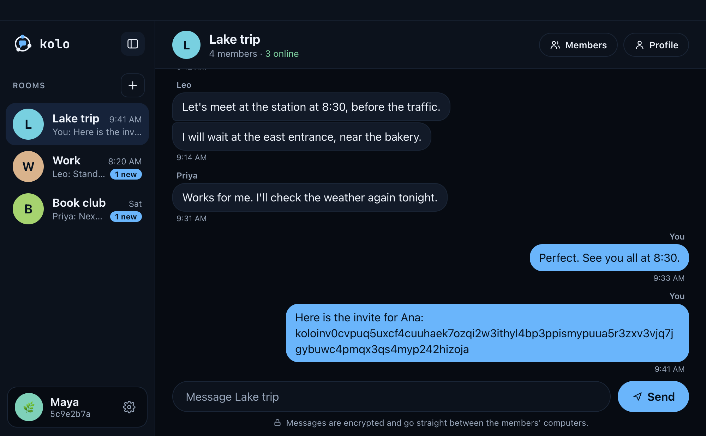

<p align="center"></p>

<h1 align="center">Kolo Chat</h1>

<p align="center"><b>An example desktop group chat where each computer sends messages straight to the others.</b></p>

<p align="center"><a href="https://github.com/ciranda-dev/kolo-chat-wails3-example/releases">Download</a> · <a href="docs/how-it-works.md">Docs</a> · <a href="CHANGELOG.md">Changelog</a></p>

<p align="center"><a href="CHANGELOG.md"></a> <a href="LICENSE"></a> <a href="go.mod"></a> <a href="go.mod"></a> <a href="#platforms"></a></p>



## What it does

- **Keep several rooms** in one window, each in a folder of its own with its own key, kolo-id, pins and invites (see [several rooms](#several-rooms)).
- **Invite people** with a code that has an expiry and a number of uses; an admin approves each request, as a member or as an admin.
- **Agree on the members**: each room keeps its member list in a [kolo-braid](https://github.com/ciranda-dev/kolo-braid) braid, so every member ends with the same list, and admins can remove a member (see [shared state](#shared-state-the-member-list)). Removing is not revocation: the removed member keeps the room key.
- **Send messages** straight to every peer that is online, or through a relay you run when two computers cannot connect directly (see [Need a relay or a pin?](#need-a-relay-or-a-pin)).
- **Talk with people who are online** with no server of your own: members connect directly and copy each other's messages, with no pin. A pin is optional.
- **Catch up** on messages that arrived while you were offline, from an encrypted copy on one or more pins you run (`-pin IP:PORT@KEY,...`, see [configuration](docs/configuration.md#pins)), even when the sender is offline too: every member derives the message keys from the room key (see [how it works](docs/how-it-works.md#opening-the-app-after-being-offline)).
- **Keep the history**: on open the window shows each room as you left it, your messages too (see [history](docs/how-it-works.md#history)).
- **Read it at a glance**: messages from the same person within five minutes sit together under one name and one time, with a chip for each day, and yours are on the right.
- **Pick a name and an avatar** in each room.
- **Skip what cannot be checked**: a message whose key does not match its signed record is not shown, and its sender is marked "unchecked"; past 256 of them the sender is not read until it joins again with a new data folder and invite (see [security](docs/security.md#other-things-to-know)).
- **Stay private on the public network**: anyone who looks up a room's topic can open a connection, but without the room key they read and join nothing, and a connection that sends no hello is closed after 10 seconds. A hostile connection can still use memory, so the example sets a soft memory limit (half of the physical memory, or `GOMEMLIMIT`; see [security](docs/security.md#someone-who-finds-the-topic)).
- **Leave a room** from Settings: it deletes that room's folder from this computer after you confirm, and the others stay (see [leaving](docs/how-it-works.md#leaving)).
- **See new messages** in the menu bar or tray, and on a Mac in the notch window, which also comes down when the pointer is on the camera housing.

## Platforms

| Platform | Install | Version | Status |
|---|---|---|---|
| macOS (universal) | `.dmg` or `.zip` | v0.1.1 | Beta, unsigned |
| Windows (amd64, arm64) | installer `.exe`, `.exe` or `.zip` | v0.1.1 | Beta, unsigned |
| Linux (amd64, arm64) | `.deb` or `.tar.gz` | v0.1.1 | Beta, unsigned |

Get the files from the [latest release](https://github.com/ciranda-dev/kolo-chat-wails3-example/releases), with `SHA256SUMS` to check them. They are not signed or notarized, so the system warns before the first run. Build your own with `scripts/release-local.sh` (see [build and test](docs/build-and-test.md)).

## Try it

You need Go 1.26 or later, Node.js with npm, and the Wails 3 CLI (`go install github.com/wailsapp/wails/v3/cmd/wails3@v3.0.0`). A **peer** is one running copy of the example. The **entry node** is the first address every peer contacts to find the others. The **pin** keeps an encrypted copy of the messages for people who are offline. Run the commands in the repository folder; `go install` puts `kolo-pin` and `kolo-node` in `$(go env GOPATH)/bin`, which must be on your `PATH`.

### Three ways to choose a network

- **Public network, the default.** Start the example with no network setting. It uses the public entry nodes built into Kolo, which Ciranda runs: free, with no uptime guarantee while Kolo is a beta. People on different networks find each other with no setup. The example listens on `0.0.0.0:0` for it.
- **Your own network.** `-bootstrap host:port[,host:port]` (or `KOLO_CHAT_BOOTSTRAP`) names the entry nodes of a network you run with kolo-node. They are used alone: the public ones are not contacted. This is how you keep a private network, and how the two-computer examples below work.
- **This computer only.** Run a kolo-node with `-first` on `127.0.0.1` and start every example with `-bootstrap 127.0.0.1:<port>`. The next section does that.

If no entry node answers (no internet, or your own nodes are down), the room says "Could not reach the network, trying again", names these three ways, keeps what you type and asks again by itself until one answers. The example never falls back to another network. There is no public pin and no public relay, and neither is needed to start (see [Need a relay or a pin?](#need-a-relay-or-a-pin)).

### Same computer

Once: build the example.

```sh
GOWORK=off wails3 build
```

Once: install the pin and the entry node.

```sh
go install github.com/ciranda-dev/kolo-pin/cmd/kolo-pin@v0.1.1
```

```sh
go install github.com/ciranda-dev/kolo-node/cmd/kolo-node@v0.1.1
```

Once: make a private folder for the demo data.

```sh
mkdir -p -m 700 /tmp/kolo-chat-demo
```

Terminal 1: the entry node of this computer's own network, on `127.0.0.1:7447`. `-first` starts a new network with no other entry nodes.

```sh
kolo-node run -listen 127.0.0.1:7447 -identity /tmp/kolo-chat-demo/node/node.key -first
```

Terminal 2: the pin, on `127.0.0.1:7450`. It is optional: leave out this terminal and the `KOLO_CHAT_PIN` line below to try without one, and messages then reach people only while they are online.

```sh
kolo-pin run -data /tmp/kolo-chat-demo/pin -max-bytes 100MB
```

Terminal 3: Alice, the founder. First the pin she uses, then a new conversation key, then her example.

```sh
export KOLO_CHAT_PIN=127.0.0.1:7450@$(kolo-pin id -data /tmp/kolo-chat-demo/pin)
```

```sh
export KOLO_CHAT_CONVERSATION_KEY=$(openssl rand -hex 32)
```

```sh
./bin/kolo-chat -data /tmp/kolo-chat-demo/alice -bootstrap 127.0.0.1:7447
```

Terminal 4: Bob, in a new terminal without those variables. For Carol, do the same in a fifth terminal with `/tmp/kolo-chat-demo/carol`.

```sh
./bin/kolo-chat -data /tmp/kolo-chat-demo/bob -bootstrap 127.0.0.1:7447
```

In Alice's window click Invite, then Create invite, and click Copy next to the code. In Bob's window click + next to Rooms, then Join a room, click Paste (or paste it in the field), give the room a name, click Join, then in Alice's window click Members and Approve as member.

### Two computers on the same network

Computer A runs the entry node, the pin and Alice; computer B runs Bob. `<ip-of-computer-a>` is A's LAN address, such as `192.168.1.10` (`ipconfig getifaddr en0` on a Mac, `hostname -I` on Linux). Build, install the pin and make the folder on each computer as above, and allow UDP ports 7447 and 7450 into A.

Both computers, once: install kolo-node.

```sh
go install github.com/ciranda-dev/kolo-node/cmd/kolo-node@v0.1.1
```

Computer A, terminal 1: the entry node on UDP port 7447. It creates its key file on the first run.

```sh
kolo-node run -listen 0.0.0.0:7447 -identity /tmp/kolo-chat-demo/node/node.key -first
```

Computer A, terminal 2: the pin, open to the network.

```sh
kolo-pin run -data /tmp/kolo-chat-demo/pin -listen 0.0.0.0:7450 -max-bytes 100MB
```

Computer A, terminal 3: Alice. The pin address goes into the invite, so it must be one B reaches. Then the conversation key and her example.

```sh
export KOLO_CHAT_PIN=<ip-of-computer-a>:7450@$(kolo-pin id -data /tmp/kolo-chat-demo/pin)
```

```sh
export KOLO_CHAT_CONVERSATION_KEY=$(openssl rand -hex 32)
```

```sh
./bin/kolo-chat -data /tmp/kolo-chat-demo/alice -bootstrap <ip-of-computer-a>:7447
```

Computer B: check that the entry node answers (it prints `ok`), then start Bob.

```sh
kolo-node check <ip-of-computer-a>:7447
```

```sh
./bin/kolo-chat -data /tmp/kolo-chat-demo/bob -bootstrap <ip-of-computer-a>:7447
```

The invite works as on one computer: copy the code from A to B by any means.

### Two computers on different networks

Use the public network: start both examples without `-bootstrap`, so no entry node is needed on your side. The example needs nothing else. If you use a pin, it needs an address both computers reach, because the invite carries it and there is no public pin: run `kolo-pin run -listen 0.0.0.0:7450` on a host with a public address, or forward UDP port 7450 on A's router to A, and use that public IPv4 address in `KOLO_CHAT_PIN` (`<public-ip-of-the-pin>:7450@<pin-key>`). The peers then connect straight to each other through their routers; two networks that block that connect only through a relay both list ([Need a relay or a pin?](#need-a-relay-or-a-pin)).

```sh
./bin/kolo-chat -data /tmp/kolo-chat-demo/alice
```

To keep a private network instead, run kolo-node on a host with a public address (see kolo-node's [deploy guide](https://github.com/ciranda-dev/kolo-node/blob/main/docs/deploy.md)) and start every example with `-bootstrap <host>:7447`.

If it does not connect: with the public network, check your internet connection; with your own, `kolo-node check` must print `ok` on both computers and both examples must use the same `-bootstrap`. If you use a pin, the one in `KOLO_CHAT_PIN` must not be `127.0.0.1` when B is another computer. More in [try it](docs/try-it.md).

Tests: `GOWORK=off go test ./...`. Live reload: `KOLO_CHAT_DATA=/tmp/kolo-chat-demo/dev GOWORK=off wails3 dev`. (`GOWORK=off` matters only inside a Go workspace.)

## Several rooms

The list on the left, under Rooms, holds your rooms, each with its avatar, its last message and its time. The + beside the heading opens a small menu: Create a room asks for a name, which only you see, and starts one that you own, with the pins of `-pin` or `-pin-file` if you gave any and with none otherwise; Join a room takes an invite code and a name. A button in the sidebar header folds the list into a rail of avatars, and the window remembers it. Each room lives in its own folder under `<data>/conversations/`, with its own key, kolo-id, logs, pins and invites, and the example runs one engine for each (`conversations.go`, where a room is called a conversation). `KOLO_CHAT_CONVERSATION_KEY`, as in [Try it](#try-it), starts one room from the command line. A local list of rooms is enough because one kolo-id lives on one device: using one account on several devices is a different problem and is not solved here.

The header of a room has its name, how many members it has and how many are online, and the buttons Invite (admins), Members and Profile. Members opens a panel with the member list, the people waiting to be let in and Remove for admins. The composer sits at the bottom, with one line under it: the messages are encrypted and go straight between the members' computers.

A data folder whose `layout.json` names a layout the example does not know is refused at start, and nothing in it is changed: use another `-data`. More in [how it works](docs/how-it-works.md#several-conversations) and [the data folder](docs/configuration.md#the-data-folder).

## Shared state: the member list

Each room keeps its member list in a braid (`state.go`, `braid.go`): every member writes its own strand, kolo-braid merges them into one order that every peer computes alike, and `applyState` turns that order into the member list (and the list of rooms a conversation holds inside it, which the engine and its API keep; the window uses the first one, `general`). The chat talks only to the keys on the member list. The braid shares each connection with the chat: every stream starts with a tag byte (`mux.go`), and a braid that breaks the protocol pauses the member list with that member while the chat goes on.

- The founder is an admin and settles changes; an admin approves each request as a member or as an admin, for good. Admins remove members, never the settler. Before the founder leaves, Settings hands settlement over to another admin.
- Removing is not revocation. Each member's example stops talking to the removed member once it learns of the removal, and an app that is offline learns it later. The removed member keeps the room key: it can still read new messages and profiles from the pins. To keep someone out for good, start a new room without them.
- At most 64 members.
- kolo-braid is beta: its settlement and membership are model-checked within bounds, which is not a proof, and it was tested on one Mac, on 127.0.0.1 only.

More in [shared state](docs/shared-state.md).

## Need a relay or a pin?

Kolo Chat uses the public entry nodes unless you pass `-bootstrap`, and it starts with no pin and no relay. There is no public pin and no public relay: [Try it](#try-it) runs your own.

- **Pin**: optional. It keeps an encrypted copy of the messages for people who are offline (see [pins](docs/configuration.md#pins)). It needs an address every member reaches: the example never reaches a pin through a relay.
  - Without a pin you can create a room, invite people and chat with everyone who is online. Each member keeps its own messages and gives them to the others directly, so a member who was offline gets a message once its sender and that member are online together. A member who joins later gets the earlier messages of each member who is online, from that member; those of a member who is offline come when that member is online again.
  - With a pin, offline members get the messages from the pin, even when the sender is offline too. A pin you give to the example goes into the invites of the rooms you start, so the people you invite use it as well.
- **Relay**: optional, for two computers behind strict NATs that cannot connect directly. When the direct connection fails, the invite, the messages and the sync of the history, names and rooms go through it. It carries them encrypted end to end and cannot read them.

A relay is needed only behind strict NATs, and you run your own on a host every member reaches, on UDP port 7448. It prints its key when it starts.

```sh
kolo-node relay -listen 0.0.0.0:7448 -identity "$HOME/kolo-node/relay.key"
```

Start every example with the same relay, `host:port@key` with the key as 64 hex characters. The invite does not carry it.

```sh
./bin/kolo-chat -relay <relay-host>:7448@<relay-key>
```

`-relay` repeats or takes a comma list, `-relay-file` reads one or more relays per line and `KOLO_CHAT_RELAYS` is used when neither flag is given. Settings shows each relay's state and which setting gave the list. More in [connection relays](docs/configuration.md#connection-relays).

### With the installed macOS app

The installed app reads `KOLO_CHAT_RELAYS` from its environment, so start it from a terminal with your relay (replace the placeholders with your relay's address and its key, 64 hex characters):

```sh
KOLO_CHAT_RELAYS="<relay-host>:7448@<relay-key>" /Applications/kolo-chat.app/Contents/MacOS/kolo-chat
```

On other systems, set the same variable in the environment of the process before it starts. The flag `-relay` and the file `-relay-file` work the same way and win over the variable.

## How it uses Kolo

| Kolo library | What the example uses it for |
|---|---|
| [kolo-id](https://github.com/ciranda-dev/kolo-id) | the identity key of each person and of the development entry node |
| [kolo-dht](https://github.com/ciranda-dev/kolo-dht) | the public entry nodes the example starts from by default, and the development entry node in `cmd/bootstrap` |
| [kolo-swarm](https://github.com/ciranda-dev/kolo-swarm) | finding the other peers of a conversation or an invite, and trying the connection relays when a direct connection fails |
| [kolo-relay](https://github.com/ciranda-dev/kolo-relay) | the connection relays are kolo-relay servers; the example names their refusals (wrong key, not allowed, full) in the window and in Settings |
| [kolo-secure](https://github.com/ciranda-dev/kolo-secure) | encrypted connections between peers |
| [kolo-log](https://github.com/ciranda-dev/kolo-log) | each member's signed log of messages and of profile data |
| [kolo-store](https://github.com/ciranda-dev/kolo-store) | keeping the logs on disk |
| [kolo-sync](https://github.com/ciranda-dev/kolo-sync) | copying logs between peers and from the pin |
| [kolo-pin](https://github.com/ciranda-dev/kolo-pin) | the pin that keeps messages for offline people |
| [kolo-invite](https://github.com/ciranda-dev/kolo-invite) | invite codes, join requests and approvals |
| [kolo-kv](https://github.com/ciranda-dev/kolo-kv) | profiles |
| [kolo-braid](https://github.com/ciranda-dev/kolo-braid) | the member list and the room list that every member agrees on |

## Where the Kolo code is

- `conversations.go`: one folder and one engine per conversation, the list, Create, Join, Leave, and the calls of the window routed by ID.
- `chatservice.go`: the engine of one conversation. `start` and `enter` open the identity, the store and the swarm; `receive`, `sendTo` and `onHello` send messages and sync logs.
- `invite.go`: invite codes, join requests, approve as a member or as an admin, and deny.
- `state.go`: the apply function of the braid, which keeps the room list.
- `braid.go`: the braid of a conversation: open or create it, serve it, the accepted set, removal and rooms.
- `braidstatus.go`: what the example adds around the braid: the window's state, the pause after a fault, the marks of refused entries and the founder's hand over.
- `mux.go`: one connection for the chat's messages, its kolo-sync and the braid, by a tag byte per stream.
- `pin.go`: pin capabilities and the encrypted copy on each pin.
- `entrykeys.go`: the entry keys, derived from the conversation key with kolo-log's derived-key mode, so a message is read from a pin while its sender is offline.
- `profile.go`: profiles in a kolo-kv store.
- `config.go`: the flags, such as `-bootstrap`, the pin list `-pin IP:PORT@KEY,...` and the relay list `-relay host:port@key,...`.
- `network.go`: joining the network the settings choose (the public one when `-bootstrap` is empty) and the error that names the three options when no entry node answers.
- `netstate.go`: how a room stays connected: the gentle start of many rooms, the retries with a growing, jittered wait, and the states the window shows.
- `relay.go`: the state of each relay for the window. The relays go to kolo-swarm's `Config.Relays` in `start`, and a relayed connection is used like a direct one: kolo-sync takes either.

## Project layout

```text
main.go, config.go      start the app; flags, environment variables and defaults
network.go              joining the public network or your own
netstate.go             the start of many rooms, the retries, the connection states
conversations.go        one folder and one engine per conversation; the methods the window calls
relay.go                the state of the connection relays
chatservice.go, pin.go  the engine of one conversation: peers, messages, sync, the pin
entrykeys.go            the entry keys every member derives from the conversation key
invite.go, profile.go   invites; profiles
state.go, braid.go      the member list and the room list in a braid
braidstatus.go          the window's state of the lists, the pause, the marks and the hand over
mux.go                  one connection for the chat and the braid
version.go, memlimit.go  the release the app reports; the soft memory limit set at start
atomicwrite.go          the synced, renamed write of every state file
notch.go, tray.go       what the notch window and the tray show
cmd/bootstrap/          a development entry node on 127.0.0.1:4000
frontend/src/App.jsx    the main window (React); frontend/notch.html is the notch page
```

## Learn more

- [Tutorial steps and tags](docs/steps.md), [how it works](docs/how-it-works.md), [profiles and rooms](docs/profiles-and-rooms.md), [shared state](docs/shared-state.md)
- [Try it on one or two computers](docs/try-it.md), [configuration](docs/configuration.md), [troubleshooting](docs/troubleshooting.md)
- [Notch and tray](docs/notch-and-tray.md), [security](docs/security.md)
- [Go API and events](docs/api.md), [build and test](docs/build-and-test.md)
- [Changelog](CHANGELOG.md), [security policy](SECURITY.md), [license](LICENSE) (Apache-2.0)
